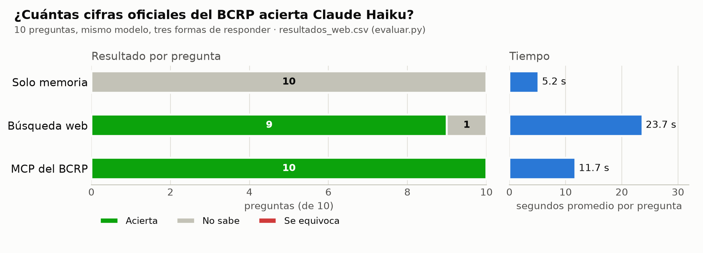

# Informe · ¿Le sirve a Claude un MCP del BCRP?

Sesión 04 · Data Science con Python. Servidor MCP con FastMCP 4.1.4 sobre las 17,167 series del BCRP, conectado a
Claude Code y evaluado con `evaluar.py` (Claude Haiku, `claude -p`) el 28 de octubre de 2026.

## Qué tiene el servidor

| Pieza | Qué hace |
|---|---|
| `buscar_series` | Busca el código de una serie por palabras en el catálogo oficial (venía hecha) |
| `serie` | Datos de una serie entre dos fechas, con la URL de la API como fuente. Traduce los periodos de la API (`Ene.2025`, `01.Oct.26`, `T1.25`, `2025`) y salta los `n.d.` |
| `resumen` | Primero, último, cambio, variación %, promedio, máximo y mínimo: las cuentas las hace Python, no el modelo |
| `correlacion` (propia) | Correlación entre dos series, en niveles y en cambios de un periodo al otro, con las dos URLs como fuente. Si las frecuencias difieren, promedia la más alta a la más baja |
| Recurso `bcrp://serie/{codigo}` | La ficha de cualquier serie (nombre, frecuencia, desde cuándo hay datos); en Claude Code se adjunta con `@` |
| Prompt `informe(tema)` | Receta de 5 viñetas con código y periodo en cada cifra; en Claude Code se lanza con `/mcp__bcrp__informe` |

Las 8 pruebas de `test_server.py` pasan (`uv run pytest -q` → `8 passed`).

Un detalle de la API que no estaba en el enunciado: el TODO 1 dice que setiembre llega como `Set`, pero el 28 de
octubre de 2026 la API respondía `Sep.2026`. El servidor acepta las dos formas; si solo aceptara `Set`, la prueba del
resumen fallaría.

## Resultados

Las 10 preguntas de `preguntas.csv`: las 8 del curso y 2 mías, `desempleo_set26` (tasa de desempleo de Lima,
PN38063GM) y `pbi_t2_26` (crecimiento del PBI en el segundo trimestre de 2026, PN02507AQ, que además prueba el formato
trimestral). Sus verdades salen de las tablas web del BCRP, no del MCP, y las revisé a mano el 28 de octubre de 2026:
[desempleo](https://estadisticas.bcrp.gob.pe/estadisticas/series/mensuales/resultados/PN38063GM/html/2026-1/2026-9/)
= 4.4 y [PBI trimestral](https://estadisticas.bcrp.gob.pe/estadisticas/series/trimestrales/resultados/PN02507AQ/html/2025-1/2026-4/)
= 2.6.

| Corrida | Archivo | Modo | Acierta | Se equivoca | No sabe | Segundos promedio |
|---|---|---|---|---|---|---|
| Base | `resultados.csv` | memoria | 0 | 0 | 10 | 5.1 |
| Base | `resultados.csv` | mcp | **10** | 0 | 0 | 11.8 |
| Sin «no sé» | `resultados_sin_null.csv` | memoria | 0 | 0 | 10 | 5.3 |
| Sin «no sé» | `resultados_sin_null.csv` | mcp | **10** | 0 | 0 | 11.7 |
| Contra la web | `resultados_web.csv` | memoria | 0 | 0 | 10 | 5.2 |
| Contra la web | `resultados_web.csv` | web | 9 | 0 | 1 | 23.7 |
| Contra la web | `resultados_web.csv` | mcp | **10** | 0 | 0 | 11.7 |



## Qué acertó cada modo y por qué

**Solo memoria: 0 de 10, siempre «no sé».** Haiku no tiene herramientas en este modo y las cifras son de 2025 y 2026.
En la columna `fuente` explica que su conocimiento llega a junio de 2026 y remite al INEI o al BCRP. No inventó ninguna
cifra.

**Búsqueda web: 9 de 10, el doble de lento.** Falló el cobre (`cobre_ago26`): solo encontró la serie anual del BCRP,
que llega a 2025, y una nota de prensa chilena con otra cifra. Prefirió no responder. En las 9 que acertó, solo 3
citan el portal de estadísticas del BCRP (tipo de cambio, reservas y desempleo). Las demás vienen de notas de prensa
(Andina, Forbes, Infomercado, Peru Retail) o del INEI: la cifra es correcta, pero la fuente es secundaria. Tardó 23.7 s
por pregunta, contra 11.7 s del MCP.

**MCP del BCRP: 10 de 10 en las tres corridas.** Cada respuesta cita el código de la serie, el periodo y la URL de la
API, así que se puede repetir. Dos casos muestran sus límites:

- `pbi_2025`: en la corrida base Claude eligió otra serie oficial del PBI (PM04863AA), que da 3.44 en vez de 3.43.
  Entra en la tolerancia, pero muestra que el BCRP publica más de una serie para lo mismo y que `buscar_series` no
  siempre devuelve primero la que pide la pregunta. En las otras dos corridas usó la serie esperada (3.4306).
- `pbi_t2_26`: en la corrida base no encontró la serie de variación interanual y la calculó desde el índice del PBI
  (PN02516AQ) con `resumen`, en vez de hacer la cuenta a mano: 2.57, correcto, pero con 9 llamadas en vez de 4 o 5.

## Experimentos extra

**Sin salida fácil.** Quité de la instrucción la frase «Si no puedes saberlo con certeza, pon valor null: no
estimes» (`uv run evaluar.py --sin-null`). Esperaba que Haiku diera números inventados, como anticipaba la clase,
pero siguió respondiendo `null` en las 10 preguntas de memoria. Una explicación posible, que no comprobé, es que el
esquema JSON de `evaluar.py` todavía permite `null`, así que el modelo sigue teniendo esa salida aunque nadie se la
ofrezca. El modo MCP no cambió: 10 de 10.

**Contra la búsqueda web** (`uv run evaluar.py --modos memoria web mcp`). La web acierta casi todo, pero tarda el doble,
depende de que alguien haya publicado la cifra en la prensa y no encontró el dato del cobre, que el MCP sí trajo.

## Dos cifras del MCP comprobadas en la web del BCRP

| Cifra | MCP | Tabla web del BCRP |
|---|---|---|
| Inflación de Lima a 12 meses, setiembre de 2026 (PN01273PM) | 4.5487 | 4.55 · [tabla](https://estadisticas.bcrp.gob.pe/estadisticas/series/mensuales/resultados/PN01273PM/html/2026-6/2026-9/) |
| Precio del cobre, agosto de 2026 (PN38784BM) | 689.6988 | 689.7 · [tabla](https://estadisticas.bcrp.gob.pe/estadisticas/series/mensuales/resultados/PN38784BM/html/2026-6/2026-9/) |

Las dos las revisé a mano en esas tablas el 28 de octubre de 2026. La web muestra las cifras redondeadas a los
decimales que publica el BCRP; el MCP devuelve cuatro decimales.

## La herramienta propia en un caso real

`correlacion("PN38784BM", "PN01207PM", "2021-01", "2026-09")`, precio del cobre contra tipo de cambio promedio
mensual, con 68 meses en común (2021-01 a 2026-08):

- correlación de los niveles: **-0.742**, que parece una relación fuerte (sube el cobre, baja el dólar);
- correlación de los cambios mes a mes: **-0.104**, casi nula.

La primera cifra engaña porque las dos series tienen tendencia. Por eso la herramienta devuelve las dos, y su
docstring le dice al modelo que use la de los cambios cuando hay tendencia. Comprobé el valor de los niveles con un
cálculo independiente en pandas: coincide.

## Conclusión

Un MCP vale la pena cuando se necesitan cifras exactas, recientes y rastreables de una fuente estructurada que se
consulta seguido: aquí acertó las 10, en la mitad del tiempo que la web, y cada cifra trae la URL de la API que la
respalda. La búsqueda web basta para datos que la prensa ya publicó, pero tarda más, cita fuentes secundarias y falla
con series menos cubiertas, como el cobre. Sin herramientas, Haiku no inventó cifras pero tampoco ayudó: el valor del
MCP no está en que el modelo sepa más, sino en que cada número se pueda verificar.

## Cómo repetirlo

```bash
uv run pytest -q                                                  # 8 passed
uv run evaluar.py                                                 # resultados.csv
uv run evaluar.py --sin-null --salida resultados_sin_null.csv     # experimento 1
uv run evaluar.py --modos memoria web mcp --salida resultados_web.csv   # experimento 2
uv run grafico.py                                                 # grafico.png
```

Las respuestas de Claude cambian un poco entre corridas (por ejemplo, la serie que elige para `pbi_2025`), así que
otra corrida puede dar otra fuente o cifras distintas en los decimales. En estas tres corridas, el conteo por modo
fue el mismo.
